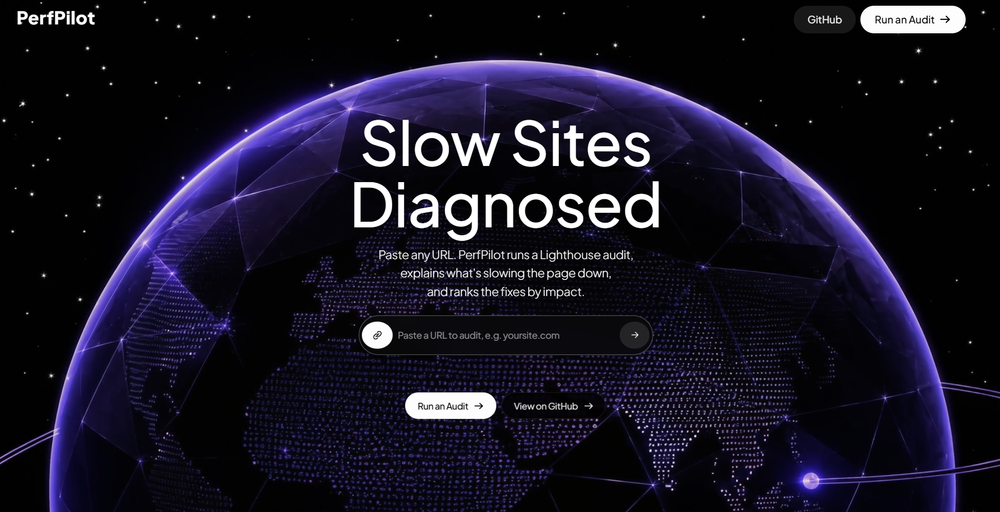
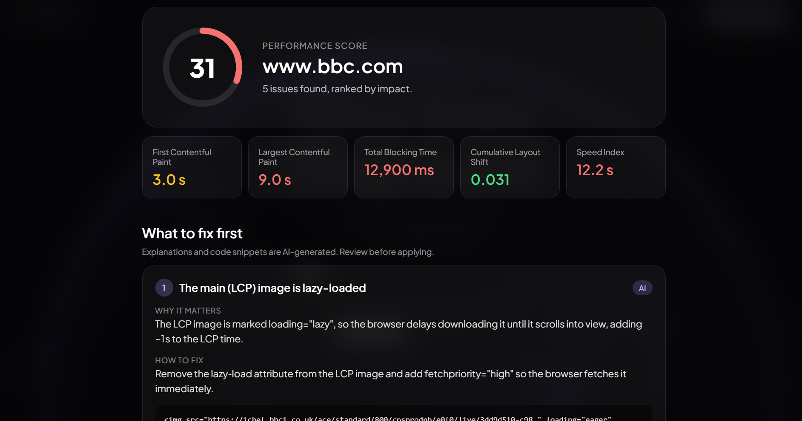
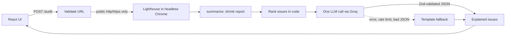

# PerfPilot

**Paste a URL. Get a Lighthouse audit, the fixes ranked by impact, and a plain-English explanation of each one, with code.**


<p>
  
  
</p>

PerfPilot runs a real Lighthouse performance audit in headless Chrome, shrinks the multi-megabyte report down to the facts that matter, ranks the problems with deterministic code, and then asks an LLM to explain only those problems. If the LLM is down, rate-limited, or returns bad JSON, you still get a complete report built from templates.


---

## Why not just use Lighthouse?

PerfPilot uses Lighthouse as its measurement engine. Lighthouse lists dozens of audits and leaves you to work out what matters. PerfPilot adds three things on top:

- **Prioritization.** Problems are ranked by estimated impact, so you know what to fix first.
- **Page-specific explanations.** Instead of a generic "Properly size images", you get advice grounded in your page's own evidence (the actual LCP element, scripts and file sizes), with a code snippet.
- **Honest output.** Every explanation is labelled as AI-generated or template-based.

## How it works



## Example output

Auditing a news homepage (mobile, simulated throttling) produced a score of 35, with LCP at 10.4 s and Total Blocking Time at 4.1 s. PerfPilot flagged that the main LCP image had `loading="lazy"`, which delays the most important image on the page, and ranked the heaviest scripts and unused JavaScript below it.

1. **Validate.** The URL is checked and its DNS answers are resolved and screened before Chrome ever starts (see [Security](#security)).
2. **Audit.** Lighthouse runs the performance category in headless Chrome.
3. **Summarize.** The raw report (a very large JSON file) is reduced to the score, five core metrics, and the audits that matter, with only a few example rows each. This keeps the LLM prompt small and cheap.
4. **Rank.** Code, not the model, decides which problems are reported and in what order.
5. **Explain.** One LLM request writes a short "why" and "fix" (plus an optional code snippet) for each selected issue.
6. **Render.** The React UI shows a score card, the core metrics, and the ranked issue list.

## Design decisions

- **Ranking is deterministic; the AI only writes text.** A lazy-loaded LCP image is detected from the LCP element's HTML and always goes first. The remaining audits are sorted by estimated time savings, then byte savings, then score impact. The model cannot add, drop, or reorder issues, so the report is reproducible and testable.
- **Every AI output is validated.** The response must match a Zod schema (string lengths are bounded). Anything that fails validation is discarded, so malformed output never reaches the UI.
- **Graceful degradation at three levels.** Retry on 429/5xx, fall back to the next model in `GROQ_MODELS`, and finally fall back to template explanations per issue. The API returns `aiUsed` and each issue carries `source: "ai" | "template"`, so the UI is honest about what was generated.
- **Prompt-injection defense.** Page content (URLs, HTML snippets) comes from the site being audited, so the system prompt marks all evidence as untrusted data and the model's output is constrained by the schema.
- **One LLM call per audit.** This stays within free-tier rate limits and keeps latency low.
- **Robust to messy real data.** Lighthouse's `details.items` is not always a list. Reads are guarded so one odd audit can't crash a report. (This was a real bug found by testing on live sites, not just a saved fixture.)
- **Repeat-visit-only audits are excluded** (for example cache lifetimes), so the top spots go to fixes that help first-time visitors.

## Security

PerfPilot makes a server fetch whatever URL a stranger types, which is a classic SSRF risk. Mitigations:

- Only `http` and `https`. Embedded credentials, non-default ports, and single-label hosts (`http://intranet`) are rejected.
- The hostname is resolved and **every** returned address is checked against blocked ranges: loopback, private (RFC 1918), link-local (including the cloud metadata address `169.254.169.254`), CGNAT, multicast, reserved, and the IPv6 equivalents.
- Numeric tricks such as `http://2130706433` (127.0.0.1 as one number) and IPv4-mapped IPv6 are normalized and blocked.
- One audit at a time, a 120 s audit timeout, request bodies capped at 10 KB, and a per-IP rate limit (6 audits per hour).

**Known gaps.** Chrome performs its own DNS lookup and follows redirects, so a malicious site could redirect to a private address or change its DNS answer between the check and the fetch (DNS rebinding). For a public deployment, run the container with no route to internal networks, and consider pinning Chrome to the validated IP with `--host-resolver-rules`. The rate limiter is in memory and resets on restart.

## Tech stack

| Layer | Tools |
|---|---|
| Frontend | React 19, TypeScript, Vite, plain CSS |
| Backend | Node.js 22, Express 5, TypeScript, Zod |
| Audit | Lighthouse 13, chrome-launcher, headless Chrome |
| LLM | Groq API (OpenAI-compatible), `openai/gpt-oss-120b` with `openai/gpt-oss-20b` as fallback |
| Packaging | Docker (Debian + Chromium, runs as non-root) |

## Run it locally

**Prerequisites:** Node.js 22+, Google Chrome (or Chromium) installed, and a free [Groq API key](https://console.groq.com).

```bash
git clone https://github.com/Rudra2004-dev/perfpilot.git
cd perfpilot
```

**Backend** (http://localhost:3001):

```bash
cd backend
npm install
cp .env.example .env        # then paste your GROQ_API_KEY
npm run dev
```

To see which model IDs your Groq key can use: `npx tsx src/listGroqModels.ts`.

**Frontend** (http://localhost:5173, proxies `/api` to the backend):

```bash
cd frontend
npm install
npm run dev
```

**Docker (backend only):**

```bash
cd backend
docker build -t perfpilot-api .
docker run --rm -p 8080:8080 -e PORT=8080 --env-file .env perfpilot-api
```

Then point the frontend at it by creating `frontend/.env.local` with `VITE_API_URL=http://localhost:8080`.

**Developing without hitting sites.** Save a report once, then iterate on it offline:

```bash
npx tsx src/try.ts https://example.com            # saves fixtures/example.com.json
npx tsx src/trySummary.ts fixtures/example.com.json
npx tsx src/tryExplain.ts fixtures/example.com.json
```

To check the SSRF validator against a list of tricky inputs: `npx tsx src/tryValidate.ts`.

## API

`GET /health` returns `{ "ok": true }`.

`POST /audit`

```json
{ "url": "https://www.example.com" }
```

Response:

```json
{
  "url": "https://www.example.com/",
  "score": 36,
  "metrics": {
    "lcp": { "value": 13500, "display": "13.5 s", "rating": "poor" }
  },
  "issues": [
    {
      "id": "lcp-image-lazy",
      "title": "The main (LCP) image is lazy-loaded",
      "savingsMs": 0,
      "why": "...",
      "fix": "...",
      "code": "",
      "source": "ai"
    }
  ],
  "aiUsed": true
}
```

| Status | Meaning |
|---|---|
| 400 | Missing or invalid URL, or a blocked address |
| 422 | The page could not be loaded |
| 429 | Another audit is running, or the rate limit was reached |
| 502 | The audit failed |
| 504 | The audit timed out |

## Project structure

```
backend/
  src/
    index.ts                      Express app, /audit and /health, rate limit, timeout
    security/validateUrl.ts       URL + DNS validation (SSRF protection)
    lighthouse/runLighthouse.ts   Launch Chrome, run Lighthouse
    summarize.ts                  Shrink the report, rank issues, extract diagnostics
    explain.ts                    LLM call, Zod validation, fallbacks
  Dockerfile
frontend/
  src/
    hooks/useAudit.ts             idle / connecting / auditing / success / error states
    lib/api.ts                    API client
    components/                   Hero, UrlInput, Results, Navbar
docs/
  hero.png
  results.png
```

## Limitations

- **Scores vary between runs.** The same page scored between 28 and 36 across my runs of one site, because Lighthouse results depend on machine load and network. Compare scores using the median of several runs, not a single one.
- **Lab data, not field data.** Lighthouse simulates a mobile device on a throttled connection. It does not reflect real-user (CrUX) numbers.
- **AI explanations and code snippets can be wrong.** They're grounded in the audit evidence, but review them before applying them.
- **Performance category only.** Accessibility, SEO, and best-practices audits are not included.

## What's next

- Unit tests for the URL validator and the ranking logic, using saved Lighthouse fixtures.
- A GitHub Action that fails a pull request when the performance score drops.
- Audit history and before/after comparison for the same URL.

## License

MIT. See [LICENSE](LICENSE).